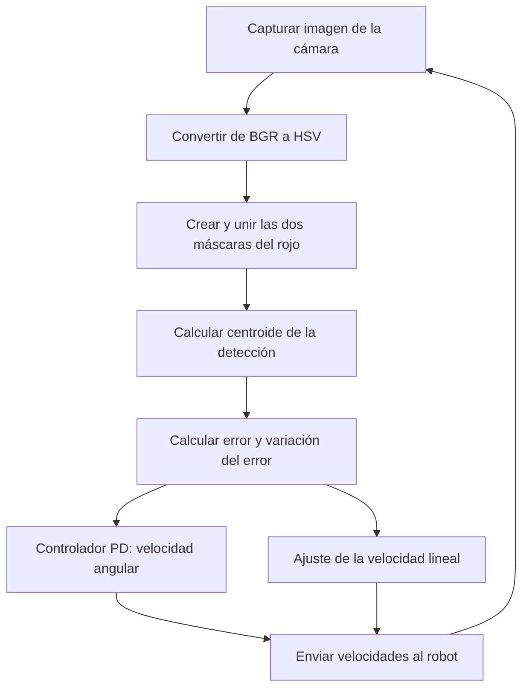

# Visual Follow Line

## Objetivo

El objetivo de esta práctica es implementar un algoritmo de **seguimiento visual de una línea roja** para que un robot sea capaz de avanzar por un recorrido y corregir su trayectoria de forma autónoma.

Para conseguirlo, utilizo la imagen capturada por la cámara y un **controlador proporcional-derivativo (PD)**. A partir de la posición de la línea en la imagen, calculo el error respecto a un punto de referencia y modifico la **velocidad angular** del robot para tratar de mantener la línea centrada. Además, adapto la **velocidad lineal** en función del error: el robot puede avanzar más rápido cuando está alineado y reduce su velocidad cuando necesita realizar una corrección mayor.

## Componentes

Para esta práctica tenemos disponible un robot con:

- **Cámara:** permite obtener imágenes del entorno y detectar la línea roja que debemos seguir.
- **Sistema de movimiento:** permite modificar la velocidad lineal (`HAL.setV()`) y la velocidad angular (`HAL.setW()`).
- **Interfaz de visualización:** mediante `WebGUI.showImage()` podemos observar la imagen procesada y el punto detectado.

La implementación se realiza en **Python**, utilizando principalmente **OpenCV** para el procesamiento de imagen y **NumPy** para definir los rangos de color.

## Método auxiliar: `detect_red(image)`

Para simplificar el programa, he creado una función que recibe la imagen capturada por la cámara y devuelve las coordenadas **`(cx, cy)` del centroide de los píxeles detectados como rojos**.

### 1. Conversión de BGR a HSV

Lo primero que hago es convertir la imagen del espacio de color **BGR**, con el que trabaja OpenCV habitualmente, al espacio **HSV**:

```python
image_hsv = cv2.cvtColor(image, cv2.COLOR_BGR2HSV)
```

HSV separa el **tono** (`H`), la **saturación** (`S`) y el **valor o brillo** (`V`), lo que facilita la segmentación por color.

### 2. Detección del color rojo

En OpenCV, el tono `H` se representa normalmente entre `0` y `179`. Como el rojo se encuentra en los dos extremos de ese intervalo, utilizo **dos rangos**:

```python
boundaries = [
    ([0, 100, 100], [10, 255, 255]),
    ([170, 100, 100], [179, 255, 255])
]

mask_h = cv2.inRange(
    image_hsv,
    np.array([0, 100, 100]),
    np.array([10, 255, 255])
)

mask_v = cv2.inRange(
    image_hsv,
    np.array([170, 100, 100]),
    np.array([179, 255, 255])
)

mask = cv2.bitwise_or(mask_h, mask_v)
```

Cada máscara es una imagen binaria: los píxeles que cumplen el rango aparecen en blanco y el resto en negro. Después uno ambas máscaras mediante una **operación OR**, de modo que detecto los rojos situados en cualquiera de los dos intervalos.

Los límites mínimos de saturación y brillo (`S ≥ 100` y `V ≥ 100`) ayudan a descartar colores poco saturados o zonas demasiado oscuras. **No obstante, la variable `mask_v` no es una máscara independiente de brillo:** en el código representa el segundo intervalo de tono rojo.

### 3. Cálculo del centroide

Una vez obtenida la máscara, utilizo los **momentos de imagen** para calcular el centroide del conjunto de píxeles detectados:

```python
M = cv2.moments(mask)

if M["m00"] != 0:
    cx = int(M["m10"] / M["m00"])
    cy = int(M["m01"] / M["m00"])
```

El momento `m00` representa el área ponderada de la máscara; `m10` y `m01` permiten calcular las coordenadas del centroide:

$$
c_x = \frac{M_{10}}{M_{00}}, \qquad c_y = \frac{M_{01}}{M_{00}}
$$

Compruebo que `m00` sea distinto de cero para evitar una división por cero cuando no se detecta ningún píxel rojo. Por último, marco el punto calculado sobre la imagen procesada y la muestro:

```python
cv2.circle(output, (cx, cy), 5, (255, 0, 0), -1)
WebGUI.showImage(output)

return (cx, cy)
```

En el seguimiento utilizo **únicamente `cx`**, ya que el control se basa en el desplazamiento horizontal de la línea respecto al punto objetivo. La coordenada `cy` se calcula, pero no interviene en la corrección.

## Funcionamiento

El programa se ejecuta en un bucle continuo que **captura, detecta, calcula y corrige**:



### 1. Definición del punto objetivo

```python
point_objetivo = 318
error = 0
error_anterior = 0
```

Establezco el **punto objetivo en `x = 318`**, que representa la posición horizontal en la que quiero mantener el centroide de la línea. Es un valor cercano al centro de una imagen de 640 píxeles de ancho, aunque el código no comprueba expresamente la resolución.

En cada iteración calculo el error:

```python
error = point_x - point_objetivo
```

$$
e(k) = x_{\text{línea}}(k) - 318
$$

- **Error igual a cero:** la línea está situada en el punto objetivo.
- **Error positivo:** el centroide se encuentra a la derecha de dicho punto.
- **Error negativo:** el centroide se encuentra a la izquierda.

El objetivo del controlador es hacer que ese error tienda a cero.

### 2. Control PD de la velocidad angular

Para corregir la orientación del robot, utilizo un **controlador proporcional-derivativo (PD)**. Este controlador combina dos acciones:

- **Proporcional (P):** corrige en función de la magnitud del error actual. Cuanto más separada esté la línea del punto objetivo, mayor será la corrección solicitada.
- **Derivativa (D):** responde a los cambios del error entre iteraciones. Permite anticipar la evolución del desplazamiento y puede amortiguar las oscilaciones, siempre que su ganancia esté bien ajustada.

La implementación es:

```python
d_error = error - error_anterior

Kp = 0.01
Kd = 0.06

u = -Kp * error - Kd * d_error
HAL.setW(u)
```

La ley de control discreta utilizada es:

$$
\omega(k) = -K_p\,e(k) - K_d\,[e(k)-e(k-1)]
$$

Donde:

| Parámetro | Valor | Función |
| --- | ---: | --- |
| `Kp` | `0.01` | Determina la intensidad de la corrección proporcional. |
| `Kd` | `0.06` | Determina la respuesta ante las variaciones del error. |
| `error` | Variable | Desplazamiento horizontal actual respecto al objetivo, en píxeles. |
| `d_error` | Variable | Diferencia del error respecto a la iteración anterior. |
| `u` | Variable | Orden enviada como velocidad angular mediante `HAL.setW()`. |

Los signos negativos forman parte de la convención de giro utilizada en este código. **Su efecto físico (izquierda o derecha) depende de la convención de signos de `HAL.setW()`** y debe comprobarse en el simulador.

**Importante:** en este programa el término derivativo es una **diferencia entre muestras**, sin dividir por el tiempo transcurrido. Por tanto, el comportamiento de `Kd` depende también de la frecuencia a la que se ejecuta el bucle. `Frequency.tick()` ayuda a regular la ejecución, pero no se calcula explícitamente un `Δt`.

### 3. Ajuste de la velocidad lineal

Además de corregir la orientación, adapto la velocidad de avance al error horizontal:

```python
Kv = 0.04
V = 16 - Kv * abs(error)
HAL.setV(V)
```

La expresión utilizada es:

$$
v(k) = 16 - 0.04\,|e(k)|
$$

Con esta estrategia:

- Cuando el robot está alineado, el error es pequeño y puede avanzar a mayor velocidad.
- Cuando la línea aparece desplazada, la velocidad lineal disminuye para facilitar la corrección de la trayectoria.
- Utilizo el valor absoluto del error porque la reducción de velocidad debe ser la misma tanto si la línea está a la izquierda como a la derecha.

Este ajuste **no forma parte del PD angular**: es una regulación proporcional independiente de la velocidad lineal. Las unidades físicas de `V` y `u` dependen de la interfaz del simulador; aquí analizo los valores enviados por el código sin asumir una conversión a m/s o rad/s.

## Análisis de los parámetros elegidos

Los parámetros finales del código son `Kp = 0.01`, `Kd = 0.06`, `Kv = 0.04` y una velocidad lineal de referencia de `16`.

### Influencia de `Kp` y `Kd`

Con un valor de **`Kp = 0.01`**, la acción proporcional es relativamente suave: por ejemplo, un error de `50` píxeles genera una contribución angular de `-0.5`.

La ganancia **`Kd = 0.06`** hace que el controlador responda con mayor intensidad a variaciones rápidas del error. Por ejemplo, si el error pasa de `40` a `50` píxeles en una iteración:

$$
\begin{aligned}
e &= 50 \\
\Delta e &= 50-40=10 \\
\omega &= -0.01(50)-0.06(10) = -1.1
\end{aligned}
$$

Sin acción derivativa, la orden habría sido `-0.5`. La derivada aumenta la corrección en este caso porque el error está creciendo. Si el error estuviera disminuyendo, el término derivativo actuaría en sentido contrario a la componente proporcional y podría contribuir a amortiguar el giro.

No obstante, **un `Kd` elevado también amplifica el ruido de la detección visual**: pequeños desplazamientos del centroide entre imágenes pueden generar cambios importantes en la velocidad angular. Por eso hay un compromiso entre rapidez de respuesta y estabilidad. Que `Kd` sea numéricamente seis veces `Kp` no significa que su efecto sea siempre seis veces mayor, ya que multiplican magnitudes distintas (`Δe` frente a `e`).

### Influencia de `Kv` sobre el avance

La siguiente tabla muestra los valores **calculados a partir de la fórmula**, no mediciones experimentales del robot:

| Error absoluto (`|e|`) | Velocidad lineal `V = 16 - 0.04·|e|` |
| ---: | ---: |
| `0` píxeles | `16` |
| `50` píxeles | `14` |
| `100` píxeles | `12` |
| `200` píxeles | `8` |
| `300` píxeles | `4` |

Por tanto, la velocidad disminuye de forma lineal cuanto mayor es el desplazamiento detectado. El valor **`Kv = 0.04`** determina cuánto se reduce el avance por cada píxel de error.

### Ejemplos de respuesta angular

| Error actual `e` | Error anterior | Variación `Δe` | Orden angular `u` |
| ---: | ---: | ---: | ---: |
| `0` | `0` | `0` | `0` |
| `50` | `50` | `0` | `-0.5` |
| `50` | `40` | `10` | `-1.1` |
| `50` | `60` | `-10` | `0.1` |

Estos ejemplos muestran por qué no basta con conocer dónde está la línea: el PD también tiene en cuenta **cómo está cambiando el error**.

## Limitaciones y posibles mejoras

Aunque la implementación permite construir un seguidor visual con control PD, he identificado algunos aspectos que convendría mejorar:

- **Pérdida de la línea:** si no aparece ningún píxel rojo, la función devuelve inicialmente `(0, 0)`. Entonces el programa interpreta un error de `-318` píxeles y sigue enviando órdenes de movimiento, aunque en realidad no conoce la posición de la línea. Sería más seguro detectar expresamente esta situación y detener o iniciar una búsqueda controlada.
- **Ruido y reflejos:** el cálculo utiliza el centroide de *todos* los píxeles rojos de la imagen. Si aparecen otros objetos rojos o reflejos, el resultado puede desviarse de la línea real.
- **Ausencia de región de interés:** al procesar toda la imagen, el centroide puede representar un tramo amplio de línea. Trabajar sobre una franja inferior de la imagen podría ofrecer una referencia más cercana a la trayectoria inmediata del robot.
- **Término derivativo sin tiempo:** dividir la diferencia de errores por el intervalo de muestreo y filtrar su resultado permitiría controlar mejor la sensibilidad al ruido y a los cambios de frecuencia.
- **Velocidades sin límites explícitos:** el código no limita `u` ni impone una velocidad mínima/máxima a `V`. Sería conveniente incorporar saturación para evitar órdenes excesivas o velocidades negativas ante errores anómalos.
- **Procesamiento redundante:** dentro de `detect_red()` se recorren los dos intervalos de `boundaries`, pero en ambas iteraciones se vuelve a utilizar exactamente la misma unión de máscaras. Este bucle no modifica el resultado y podría eliminarse.
- **Visualización en HSV:** `output` se genera en HSV, mientras que la visualización suele esperar BGR. Convertirlo de vuelta a BGR antes de mostrarlo permitiría representar los colores correctamente.

## Conclusión

En esta práctica he implementado un sistema de **seguimiento visual de una línea roja** que combina visión artificial y control de movimiento. Mediante OpenCV identifico los píxeles rojos de la imagen y calculo su centroide; después utilizo un **PD para ajustar la velocidad angular** según el error horizontal y su variación entre iteraciones.

Además, he añadido una regulación de la **velocidad lineal en función del error**, de modo que el robot reduce su avance cuando necesita corregir más su orientación. El aspecto más importante del ajuste es encontrar un equilibrio entre **rapidez de corrección y estabilidad**, especialmente en la elección de `Kd`, porque una ganancia derivativa demasiado alta puede amplificar pequeñas variaciones de la detección y provocar oscilaciones.

La estructura propuesta es sencilla y permite seguir desarrollando el sistema mediante mejoras en la detección, el tratamiento de la pérdida de línea y la limitación de velocidades. **Con el código disponible se puede analizar el funcionamiento esperado, pero no cuantificar el rendimiento real sin registros o pruebas de ejecución.**

## Vídeo de demostración

<!-- Añadir aquí el vídeo de la práctica o su enlace a GitHub cuando esté disponible. -->
